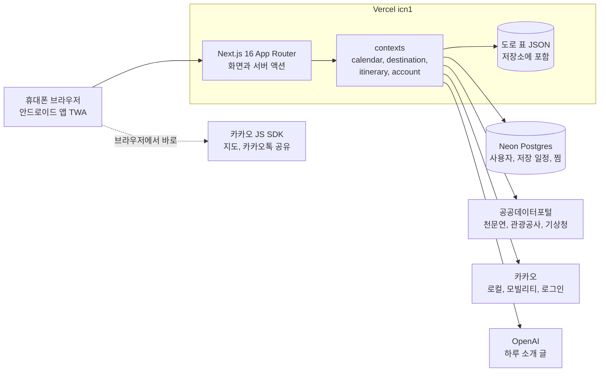
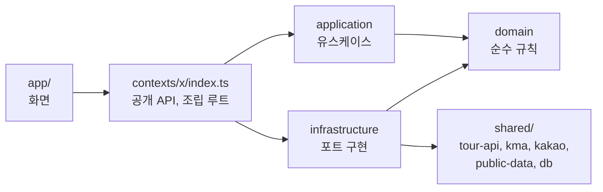
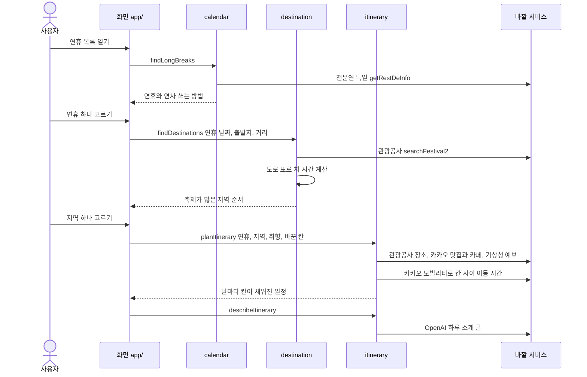
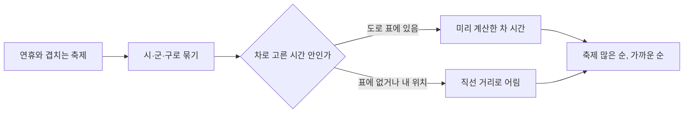
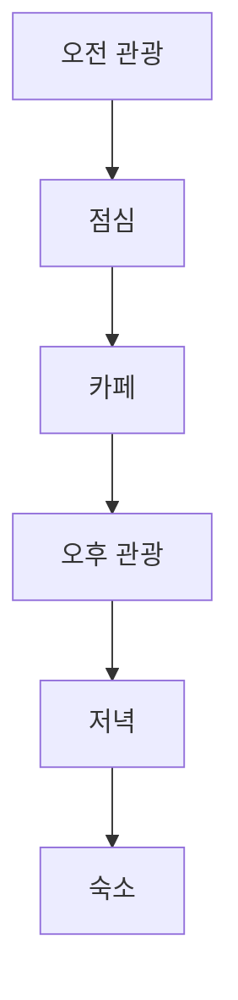
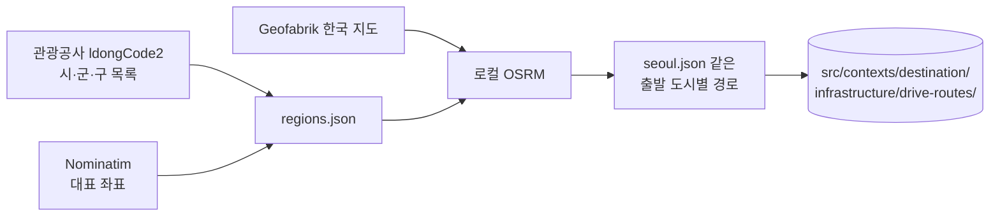
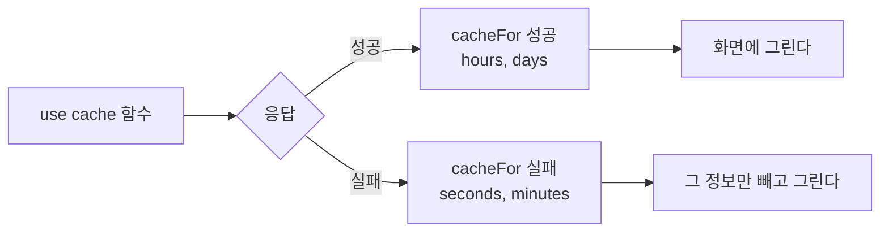

# 뇌빼고 구조와 데이터 흐름

이 문서는 앱이 어떤 조각으로 나뉘고 데이터가 어디서 와서 어디로 가는지 적는다. 처음 코드를 여는 사람이 한 번 읽고 어디를 고쳐야 할지 짐작할 수 있게 하는 것이 목표다. 실행 방법과 환경변수는 [`README.md`](../README.md)에 있고 제품 요구사항과 알려진 위험은 [`PRD.md`](PRD.md)에 있다.

## 1. 전체 모습

사용자는 휴대폰 브라우저나 안드로이드 앱으로 들어온다. 안드로이드 앱은 운영 사이트를 감싼 TWA라서 둘 다 같은 Next.js 서버를 본다. 서버는 Vercel 서울 리전에서 돌고 공공데이터포털과 카카오와 OpenAI 를 부르며 저장은 Postgres 에 한다.

카카오 지도와 카카오톡 공유만 브라우저가 직접 부르고 나머지는 모두 서버가 부른다. 그래서 브라우저에 나가는 키는 카카오 JavaScript 키 하나다.

## 2. 코드 구조

`src/contexts/` 아래에 바운디드 컨텍스트 네 개가 있고 각각 domain, application, infrastructure 레이어로 나뉜다.

| 컨텍스트 | 맡는 일 | 바깥에서 받는 것 |
|---|---|---|
| `calendar` | 공휴일로 연휴를 찾고 남은 연차로 1년 계획을 짠다 | 천문연 특일 |
| `destination` | 출발지와 축제로 갈 곳을 추천한다 | 관광공사 축제, 도로 표, 카카오 동네 이름 |
| `itinerary` | 하루 일정을 짜고 저장과 공유와 찜을 다룬다 | 관광공사, 카카오 로컬과 모빌리티, 기상청, OpenAI, Postgres |
| `account` | 카카오 로그인 사용자를 만든다 | 카카오 로그인, Postgres |

의존은 한 방향으로만 흐른다. 거꾸로 가는 import 는 `eslint.config.mjs` 의 `no-restricted-imports` 가 막는다.

domain 은 포트라는 인터페이스만 정하고 바깥 서비스를 모른다. infrastructure 가 그 포트를 관광공사나 카카오로 구현하고 `index.ts` 가 둘을 꽂는다. 예를 들어 itinerary 의 식당 찾기 포트는 카카오 REST 키가 있으면 카카오 로컬로 꽂히고 없으면 관광공사 음식점으로 꽂힌다.

컨텍스트끼리는 서로 import 하지 않는다. 화면이 calendar 에서 받은 연휴 날짜를 destination 과 itinerary 에 넘긴다.

## 3. 화면별 데이터 흐름

사용자는 연휴를 고르고 갈 곳을 고른 뒤 일정을 본다. 주소가 곧 상태라서 화면마다 주소 값만으로 결과를 다시 만든다.

| 화면 | 주소 | 부르는 유스케이스 |
|---|---|---|
| 연휴 목록 | `/` | `findLongBreaks` |
| 갈 곳 | `/breaks/[start]` | `findLongBreak`, `findDestinations` |
| 일정 | `/breaks/[start]/[region]` | `findLongBreak`, `planItinerary`, `describeItinerary` |
| 공유 | `/t/[id]` | `findSavedItinerary` |
| 찜 | `/saved` | `listFavorites` |
| 연휴 구독 캘린더 | `/holidays.ics` | `findLongBreaks` (올해와 내년) |

저장은 이 흐름의 끝에 붙는다. 「저장」을 누르면 서버 액션이 주소 값으로 일정을 한 번 짜 보고, 짤 수 있으면 연휴와 지역과 취향과 바꾼 칸과 제목만 `saved_itineraries` 에 남긴다. 장소는 남기지 않는다. 공유 페이지 `/t/{id}` 는 열 때마다 이 값으로 일정을 다시 짜서 보여 주므로 저장할 때와 내용이 다를 수 있다.

## 4. 비즈니스 규칙

규칙은 모두 domain 의 순수 함수에 있어서 Vitest 로 바깥 서비스 없이 시험한다.

### 4.1 연휴 찾기

`calendar/domain/long-break-planner.ts` 가 한 해 달력을 훑는다. 바로 앞날과 다음 날이 출근일인 구간만 연휴 후보로 보고 구간 안의 출근일은 연차로 메운다. 쉬는 날이 사흘은 돼야 공휴일 덕을 본 연휴로 친다.

연차를 더 쓰는 방법은 쓴 날수보다 쉬는 날이 더 늘어날 때만 남긴다. 하루 쓰고 하루 느는 건 아무 주말에나 할 수 있어서 추천할 거리가 아니기 때문이다.

남은 연차로 1년 계획을 짤 때는 `leave-budget.ts` 가 연휴마다 연차를 몇 개 쓸지 정해 쉬는 날 합이 가장 큰 조합을 고른다. 같은 날수면 연차를 덜 쓰는 쪽을 고른다.

### 4.2 갈 곳 추천

`destination/domain/destination-recommender.ts` 가 연휴와 겹치는 축제를 시·군·구로 묶는다. 출발지에서 20km 안의 동네와 고른 거리보다 먼 곳을 빼고 축제가 많은 순서로, 같으면 가까운 순서로 줄 세운다.

거리 칩은 「차로 2시간」「차로 4시간」「어디든」이다. 고르지 않으면 연휴 길이로 정하는데 이틀 이하면 2시간이고 사흘이면 4시간이며 나흘 이상이면 어디든이다. 제주는 차 시간으로 잴 수 없어서 「어디든」을 고르고 사흘 이상일 때만 넣는다.

### 4.3 하루 일정

`itinerary/domain/trip-planner.ts` 가 일정 뼈대를 짠다. 한 지역 일정은 2박 3일까지다.

하루는 칸으로 나뉜다. 첫날은 오는 데 오전을 쓰고 마지막 날은 점심을 먹고 돌아간다. 방문 칸에는 그날 열리는 축제를 먼저 넣고, 나머지는 바로 앞 방문지에서 가장 가까운 곳으로 이어 동선을 줄인다. 비 오는 반나절에는 실내 장소를 고르지만 축제 칸은 그대로 둔다.

식사와 카페와 숙소 칸은 domain 이 「어느 방문지 근처」인지만 정하고 실제 가게는 application 이 근처에서 고른다. 식당은 5km 안에서 많이 찾는 순서로 고르고 체인 지점과 못 먹는 음식은 뺀다. 숙소는 호텔과 한옥을 먼저 고르고 모텔을 마지막에 고른다.

사용자가 칸을 바꾸거나 여행 취향을 고르면 그 값이 `?pick=` 와 `?with=` 같은 주소에 남는다. 화면은 주소 값으로 일정을 처음부터 다시 짜고, 고른 칸은 고정한 채 나머지 칸만 자동으로 채운다.

## 5. 바깥 서비스

### 5.1 한눈에 보기

| 서비스 | 키 | 어디서 부르나 | 없거나 실패하면 |
|---|---|---|---|
| 공공데이터포털 | `DATA_GO_KR_SERVICE_KEY` | 서버 | 연휴 목록과 갈 곳 화면이 멈추고 이유를 알린다. 날씨는 빠지기만 한다 |
| 카카오 로컬과 모빌리티 | `KAKAO_REST_API_KEY` | 서버 | 맛집과 카페는 관광공사 음식점으로 찾고 이동 시간은 직선 거리로 어림한다 |
| 카카오 로그인 | `KAKAO_REST_API_KEY`, `KAKAO_CLIENT_SECRET` | 서버 | 로그인 버튼을 숨긴다 |
| 카카오 지도와 공유 SDK | `NEXT_PUBLIC_KAKAO_MAP_KEY` | 브라우저 | 지도와 「카톡 보내기」가 빠진다 |
| OpenAI | `OPENAI_API_KEY` | 서버 | 하루 소개 글 없이 일정만 보여 준다 |
| 오픈스트리트맵과 OSRM | 없음 | 개발자 컴퓨터에서 스크립트로만 | 실행 중에는 부르지 않는다 |

### 5.2 공공데이터포털

모든 호출은 `src/shared/public-data/public-data.ts` 를 거친다. 이 파일이 인증키를 붙이고 거절 코드를 실패 종류로 바꾼다. 실패 종류는 키 없음과 결과 코드 22로 오는 한도 초과와 거절과 연결 실패 네 가지다. 키가 URL 에 들어가므로 URL 과 에러 원문은 로그에 남기지 않는다.

| API | 오퍼레이션 | 쓰는 곳 | 캐시 |
|---|---|---|---|
| 천문연 특일 | `getRestDeInfo` | 공휴일 | `days` |
| 관광공사 KorService2 | `searchFestival2` | 연휴와 겹치는 축제 | `hours` |
| | `areaBasedList2` | 지역의 관광지, 숙소, 음식점 | `hours` |
| | `locationBasedList2` | 근처 장소, 바꿀 후보 | `hours` |
| | `detailCommon2` | 한 줄 소개와 축제 홈페이지 | `days` |
| | `detailIntro2` | 장소 주차 안내 | `days` |
| | `ldongCode2` | 시·군·구 목록. 도로 표 스크립트에서만 | 없음 |
| 기상청 단기예보 | `getVilageFcst` | 출발 3일 안의 시간별 날씨 | `hours` |
| 기상청 중기예보 | `getMidLandFcst` | 4일부터 10일까지 오전과 오후 날씨 | `hours` |

### 5.3 카카오

REST 호출은 `src/shared/kakao/kakao-rest.ts` 의 `kakaoGet` 을 거친다. 5초가 지나면 끊고 실패하면 라벨과 상태 코드만 로그에 남긴다.

| API | 주소 | 쓰는 곳 | 캐시 |
|---|---|---|---|
| 로컬 좌표로 행정구역 | `/v2/local/geo/coord2regioncode.json` | 「내 위치로」의 「종로구 근처」 | 캐시 안 함 |
| 로컬 키워드와 분류 검색 | `/v2/local/search/keyword.json`, `category.json` | 맛집 `FD6`, 카페 `CE7` | `hours` |
| 로컬 분류 검색 | `/v2/local/search/category.json` | 500m 안의 주차장 `PK6` | `hours` |
| 로컬 키워드 검색 | `/v2/local/search/keyword.json` | 숙소의 카카오맵 「별점과 리뷰」 링크 `AD5` | `hours`, 못 찾으면 `minutes` |
| 모빌리티 길찾기 | `apis-navi.kakaomobility.com/v1/directions` | 일정 안 칸 사이 차 시간 | 캐시 안 함 |
| 로그인 | `kauth.kakao.com/oauth/*`, `kapi.kakao.com/v2/user/me` | 회원 번호와 닉네임 | 없음 |
| 지도 SDK | `dapi.kakao.com/v2/maps/sdk.js` | 지도 그리기. 브라우저에서 | 없음 |
| 공유 SDK 2.8.3 | `t1.kakaocdn.net/kakao_js_sdk` | 「카톡 보내기」. 브라우저에서 | 없음 |

카카오 길찾기와 로컬 결과는 캐시와 보관이 금지될 수 있다. 그래서 갈 곳 화면의 차 시간은 카카오가 아니라 오픈스트리트맵으로 미리 계산하고 새 기능에서는 카카오 결과를 저장하지 않는다. 길찾기와 동네 이름은 캐시하지 않고 부를 때마다 새로 받는다. 맛집과 카페와 주차장과 숙소 링크 검색은 몇 시간만 캐시한다. 저장 일정에는 카카오 가게 정보를 남기지 않는다. 바꾼 칸 `picks` 에는 `kakao:<id>` 같은 장소 id 가 남는데, id 는 보관해도 된다는 답을 카카오에서 받았다.

### 5.4 오픈스트리트맵과 OSRM

갈 곳 화면의 차 시간과 도로 모양은 `scripts/build-drive-routes.mjs` 가 미리 만든다. 개발자 컴퓨터에서 Geofabrik 의 한국 지도를 받아 Docker 로 OSRM v5.27.1 을 띄우고 출발 도시 17곳에서 전국 시·군·구까지 경로를 계산한다. 시·군·구 대표 좌표는 Nominatim 지명 검색으로 찾는데 사용 정책대로 1초에 한 번만 부른다.

결과 JSON 은 저장소에 커밋한다. 실행 중에는 길찾기를 부르지 않아서 사용자가 늘어도 호출 수가 늘지 않는다. 값은 막히지 않을 때 기준이라 연휴 정체를 반영하지 않고 도로 표는 1년에 한 번쯤 다시 만든다. 데이터는 ODbL 이라 화면 아래 「정보 출처」에 밝힌다.

### 5.5 OpenAI

`itinerary/infrastructure/openai-trip-writer.ts` 가 Responses API 로 하루마다 2문장이나 3문장짜리 소개 글을 받는다.

| 설정 | 값 |
|---|---|
| 모델 | `gpt-6.1-sol` |
| 추론 | `reasoning.effort: "low"` |
| 출력 | `json_schema` strict, `max_output_tokens: 4000` |
| 제한 | 30초, 재시도 1번 |
| 캐시 | 성공 `days`, 실패 `minutes` |

같은 지역과 장소 목록이면 하루 동안 다시 부르지 않는다. 칸을 직접 바꾸거나 취향을 고른 일정에는 소개 글을 붙이지 않는데, 조합마다 부르면 비용이 늘기 때문이다. 시스템 프롬프트는 주어지지 않은 영업시간이나 가격을 지어내지 말라고 막는다.

### 5.6 그 밖

구글 캘린더와 네이버 지도와 티맵과 카카오맵 길찾기는 API 를 부르지 않고 링크만 만든다. 공유 미리보기 이미지 `t/[id]/opengraph-image.tsx` 는 Google Fonts 에서 Jua 글꼴을 쓰는 글자만 받는다. 4초 안에 못 받으면 `public/og.png` 기본 이미지를 대신 보낸다.

## 6. 캐시와 실패

바깥 호출은 모두 `use cache` 함수 안에 있고 `src/shared/cache.ts` 의 `cacheFor` 로 수명을 정한다. 성공은 `hours` 나 `days` 프로필로 오래 두고 실패는 `seconds` 나 `minutes` 로 잠깐만 둔다.

`use cache` 함수는 실패를 던지지 않고 `{ ok: false }` 같은 값으로 돌려준다. 던진 에러는 캐시 경계를 넘으면서 종류와 메시지를 잃기 때문이다. 화면은 그 값을 보고 해당 정보만 빼고 나머지를 그린다.

Vercel 에서 `use cache` 는 서버 메모리에 있어서 요청과 배포 사이에 이어지지 않을 수 있다. 그러면 같은 조회로 공공데이터포털을 다시 부르게 되고 하루 한도에 닿을 수 있다. 이 위험은 PRD 7장에 있고 대응은 보류 중이다.

## 7. 저장하는 데이터

Postgres 테이블은 `src/shared/db/schema.ts` 에 있는 세 개다.

| 테이블 | 담는 것 |
|---|---|
| `users` | 카카오 회원 번호와 닉네임 |
| `saved_itineraries` | 연휴와 지역과 바꾼 칸, 그리고 `snapshot` 의 연휴 끝날과 취향과 제목. 예전에 저장한 행의 `snapshot` 에는 일정 전체가 들어 있다 |
| `favorites` | 사용자와 저장 일정의 찜 관계 |

위치는 저장하지 않는다. 「내 위치로」를 누르면 좌표를 약 1km 단위로 줄여 주소 `?from=here:위도,경도` 에만 남긴다. 로그인 세션은 `AUTH_SECRET` 으로 서명한 쿠키에 둔다.
